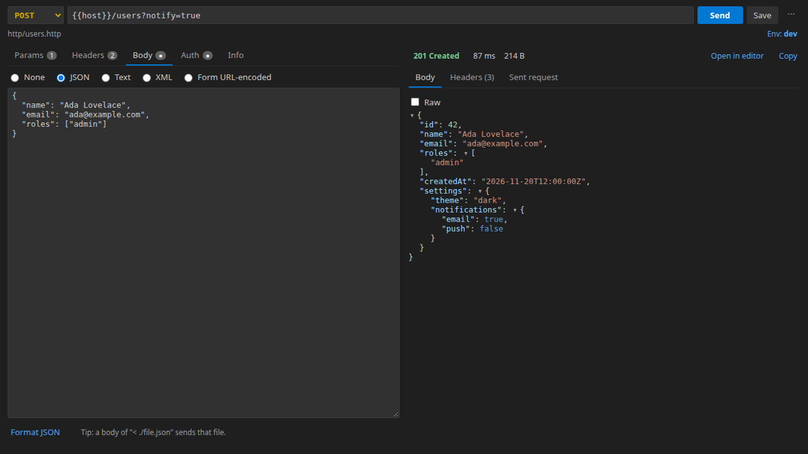

# Plainwire — API client for VS Code with plain `.http` files

A GUI API client for VS Code, Cursor, Windsurf and VSCodium. **No login, no account, no limits, no telemetry.**
Every request is saved as a plain `.http` file in your repository, in the format REST Client and the
JetBrains HTTP Client already use, so git is your sync and teammates without the extension can still read and run them.



## Features

- **Request editor**: method, URL, query-parameter table, headers table (untick to disable), body (JSON, text, XML, form), Bearer/Basic auth helpers. `Ctrl/Cmd+Enter` sends, `Ctrl/Cmd+S` saves.
- **Response viewer**: status, time, size, collapsible JSON, headers, the exact request that was sent, image preview, open the body in an editor tab.
- **Plain files**: requests live in `.http` / `.rest` files. *Send · Open in Plainwire · Copy as cURL* above every request; `Ctrl/Cmd+Alt+Enter` sends the request under the cursor.
- **Variables and environments**: `@var = value`, `{{var}}`, environments from `http-client.env.json` + `http-client.private.env.json` or the `rest-client.environmentVariables` setting, system variables (`{{$guid}}`, `{{$timestamp}}`, `{{$randomInt 1 10}}`, `{{$datetime iso8601}}`, `{{$processEnv NAME}}`, `{{$dotenv NAME}}`), and request chaining (`{{login.response.body.$.token}}` sends `login` first if needed).
- **Import**: Thunder Client collection exports and the `thunder-tests` workspace folder, Postman v2.0/v2.1 collections and environments, cURL commands (or paste a cURL command into the URL box). Export any request as cURL.
- **Sidebar**: every `.http` file in the workspace with its requests, plus a local history of sent requests.
- Requests are sent from the extension host (Node), so there are no CORS problems.

## Example

```http
@host = https://api.example.com

### Log in
# @name login
POST {{host}}/login
Content-Type: application/json

{ "user": "ada", "password": "{{$dotenv API_PASSWORD}}" }

### Who am I
GET {{host}}/me
Authorization: Bearer {{login.response.body.$.token}}
```

## Install

Until the Marketplace and Open VSX listings are live, download `plainwire-<version>.vsix` from
[Releases](https://github.com/janwan2003/vscode-api-client/releases/latest) and run
**Extensions: Install from VSIX…** (or `code --install-extension plainwire-0.1.0.vsix`; same for `cursor` / `codium`).

## Privacy

Plainwire makes no network calls except the requests you send. History stays in VS Code's local workspace storage.
See the [privacy policy](https://janwan2003.github.io/vscode-api-client/privacy.html).

## Not yet

Scripting, test assertions and a collection runner, GraphQL editor, WebSocket/SSE, OAuth2 flows, self-signed
certificates, ports on the browser fetch "bad port" list (e.g. 6000, 6665–6669).

## Develop

```sh
pnpm install
pnpm typecheck && pnpm test     # unit tests (esbuild + node:test)
pnpm build                      # dist/extension.js
node scripts/e2e.mjs /path/to/vscode/electron-binary   # end-to-end in a real VS Code, headless
pnpm package                    # .vsix
```

MIT licensed.
