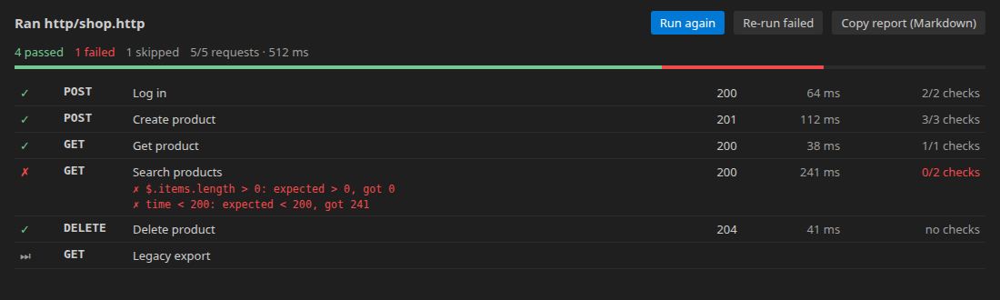

# Plainwire — API client for VS Code with plain `.http` files

A GUI API client for VS Code, Cursor, Windsurf and VSCodium. **No login, no account, no limits, no telemetry.**
Every request is saved as a plain `.http` file in your repository, in the format REST Client and the
JetBrains HTTP Client already use, so git is your sync and teammates without the extension can still read and run them.


## Features

- **Request editor**: method, URL, query-parameter table, headers table (untick to disable), body (JSON, text, XML, form), Bearer/Basic auth helpers. `Ctrl/Cmd+Enter` sends, `Ctrl/Cmd+S` saves.
- **Response viewer**: status, time, size, collapsible JSON, headers, the exact request that was sent, image preview, open the body in an editor tab.
- **Plain files**: requests live in `.http` / `.rest` files. *Send · Open in Plainwire · Copy as Code…* above every request; `Ctrl/Cmd+Alt+Enter` sends the request under the cursor.
- **Variables and environments**: `@var = value`, `{{var}}`, environments from `http-client.env.json` + `http-client.private.env.json` or the `rest-client.environmentVariables` setting, system variables (`{{$guid}}`, `{{$timestamp}}`, `{{$randomInt 1 10}}`, `{{$datetime iso8601}}`, `{{$processEnv NAME}}`, `{{$dotenv NAME}}`), and request chaining (`{{login.response.body.$.token}}` sends `login` first if needed).
- **Import**: Thunder Client collection exports and the `thunder-tests` workspace folder, Postman v2.0/v2.1 collections and environments, **OpenAPI 3.0/3.1 and Swagger 2.0** definitions in YAML or JSON (one file per tag, example bodies, auth, a status check per request), cURL commands (or paste a cURL command into the URL box). Export any request as cURL.
- **Tests and Run all (free, no run limits)**: add checks as `# @assert` lines (`status == 200`, `$.id exists`, `time < 500`, `header content-type contains json`, `$.items.length > 0`, `$.email matches /@example\.com$/`) or in the editor's Tests tab. *Run all* sends every request in a file, folder or workspace in order and shows a pass/fail report you can re-run or copy as Markdown. Thunder Client tests and common Postman test snippets are converted on import. [Syntax guide](https://janwan2003.github.io/vscode-api-client/api-tests-in-http-files.html).
  
- **Real-world networking**: any port, self-signed certificates (`# @insecure` per request or `plainwire.rejectUnauthorized: false`), HTTP proxies (`plainwire.proxy`, VS Code's `http.proxy`, `HTTPS_PROXY`), header names sent with your casing, gzip/deflate/brotli.
- **Free CLI and GitHub Action for CI**: `plainwire run api/ --env staging --junit results.xml` runs the same files in your pipeline, with no account and no run limits. One file, Node 18+. [CI guide](https://janwan2003.github.io/vscode-api-client/run-http-files-in-ci.html).
- **GraphQL**: `X-REQUEST-TYPE: GraphQL` requests (REST Client's format: query, blank line, variables JSON), with a Query + Variables editor. [Guide](https://janwan2003.github.io/vscode-api-client/graphql-requests-vscode.html).
- **Copy as Code**: cURL, JavaScript/Node.js fetch, Python requests, Go, HTTPie, PowerShell, wget, C#, PHP, Java, with variables resolved.
- **httpYac compatible tests**: `?? status == 200`-style lines run as checks too.
- **Sidebar**: every `.http` file in the workspace with its requests, plus a local history of sent requests.
- Requests are sent from the extension host (Node), so there are no CORS problems.

## Example

```http
@host = https://api.example.com

### Log in
# @name login
# @assert status == 200
# @assert $.token exists
POST {{host}}/login
Content-Type: application/json

{ "user": "ada", "password": "{{$dotenv API_PASSWORD}}" }

### Who am I
# @assert $.name == "ada"
GET {{host}}/me
Authorization: Bearer {{login.response.body.$.token}}
```

## Install

Until the Marketplace and Open VSX listings are live, download `plainwire-<version>.vsix` from
[Releases](https://github.com/janwan2003/vscode-api-client/releases/latest) and run
**Extensions: Install from VSIX…** (or `code --install-extension plainwire-0.4.0.vsix`; same for `cursor` / `codium`).

## Run the same files in CI

```sh
curl -fsSLO https://github.com/janwan2003/vscode-api-client/releases/latest/download/plainwire.mjs
node plainwire.mjs run api/ --env staging --junit results.xml
```

```yaml
# .github/workflows/api-tests.yml
- uses: actions/checkout@v4
- uses: janwan2003/vscode-api-client@v0.4.0
  with:
    files: api/
    env: ci
```

Exit code 1 when a check fails; a job summary and inline annotations on the PR. Details: [cli/README.md](cli/README.md).

## Privacy

Plainwire makes no network calls except the requests you send. History stays in VS Code's local workspace storage.
See the [privacy policy](https://janwan2003.github.io/vscode-api-client/privacy.html).

## Not yet

JavaScript pre-request/test scripts, GraphQL schema autocomplete, WebSocket/SSE, OAuth2 flows,
SOCKS proxies, client certificates.

## Develop

```sh
pnpm install
pnpm typecheck && pnpm test     # unit tests (esbuild + node:test)
pnpm build                      # dist/extension.js
node scripts/e2e.mjs /path/to/vscode/electron-binary   # end-to-end in a real VS Code, headless
pnpm package                    # .vsix
pnpm build:cli                  # dist/cli/plainwire.mjs + npm tarball
```

MIT licensed.
