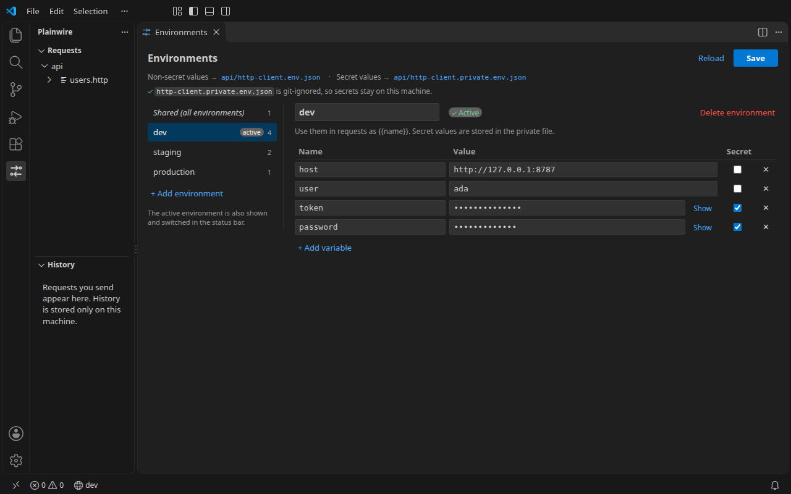

# Plainwire — API client for VS Code with plain `.http` files

A GUI API client for VS Code, Cursor, Windsurf and VSCodium. **No login, no account, no limits, no telemetry.**
Every request is saved as a plain `.http` file in your repository, in the format REST Client and the
JetBrains HTTP Client already use, so git is your sync and teammates without the extension can still read and run them.


## Features

- **Request editor**: method, URL, query-parameter table, headers table (untick to disable), body (JSON, text, XML, form), Bearer/Basic auth helpers. `Ctrl/Cmd+Enter` sends, `Ctrl/Cmd+S` saves.
- **Response viewer**: status, time, size, collapsible JSON, headers, the exact request that was sent, image preview, open the body in an editor tab.
- **Plain files**: requests live in `.http` / `.rest` files. *Send · Open in Plainwire · Copy as Code…* above every request; `Ctrl/Cmd+Alt+Enter` sends the request under the cursor.
- **Variables and environments**: `@var = value`, `{{var}}`, environments from `http-client.env.json` + `http-client.private.env.json` or the `rest-client.environmentVariables` setting, system variables (`{{$guid}}`, `{{$timestamp}}`, `{{$randomInt 1 10}}`, `{{$datetime iso8601}}`, `{{$processEnv NAME}}`, `{{$dotenv NAME}}`), and request chaining (`{{login.response.body.$.token}}` sends `login` first if needed).
- **OAuth 2.0** (new in 0.10): describe the provider once under `"Security": { "Auth": { "my-api": { … } } }` in `http-client.env.json` (the JetBrains HTTP Client format; secrets in `http-client.private.env.json`, merged key by key) and write `Authorization: Bearer {{$auth.token("my-api")}}`. The token is fetched before the request, cached, and refreshed when it expires. Client Credentials, Authorization Code with PKCE (browser sign-in, loopback redirect), Password, Device Authorization, Implicit and Mock; `{{$auth.idToken("my-api")}}`; *Plainwire: Acquire OAuth 2 Token…* / *Clear OAuth 2 Tokens*; completions for every key while editing the env file; the same in the CLI. [Guide](https://janwan2003.github.io/vscode-api-client/oauth2-http-file-vscode.html).
- **Cookies and session logins** (new in 0.9): cookies a response sets are sent with later requests, redirects included, so a login works like in a browser. Cookies tab in the response view, *Plainwire: Manage Cookies…*, `# @assert cookie sid exists`, `# @no-cookie-jar`, and the same jar in the CLI (`--no-cookie-jar` to turn it off). [Guide](https://janwan2003.github.io/vscode-api-client/cookies-session-login-http-file.html).
- **OpenAPI from a URL** (new in 0.8): *Plainwire: Import OpenAPI / Swagger…* → *From a URL…*, or `plainwire import https://…/openapi.json`. Relative server URLs (`/api/v3`) resolve against the definition's URL.
- **Server-sent events** (new in 0.7): `text/event-stream` responses show event by event as they arrive, with Stop, `# @max-events 3`, `# @timeout 30s`, and checks such as `# @assert events[-1].data == "[DONE]"` or `events[0].data.text == Hi` (JSON data is parsed). The CLI prints the event count.
- **Shared files** (new in 0.6): `# @import ../shared/auth.http` (httpYac) or `import ../shared/auth.http` (JetBrains) makes another file's variables and named requests available, so one login request serves every file. The importing file's own variables win; nested imports and cycles are handled. Works in the editor, Run all and the CLI.
- **Import**: Thunder Client collection exports and the `thunder-tests` workspace folder, Postman v2.0/v2.1 collections and environments, **OpenAPI 3.0/3.1 and Swagger 2.0** definitions in YAML or JSON (one file per tag, example bodies, auth, a status check per request), cURL commands (or paste a cURL command into the URL box). Export any request as cURL.
- **Fewer dead ends** (new in 0.15): a missing `{{variable}}` names the environment that defines it with a one-click *Use dev and send*; clicking a Run all row opens that request with the run's response and checks; imports show up in the Requests view; Save asks for the request's name.
- **Side by side, filterable responses** (new in 0.14): the response sits next to the request (drag the divider, or switch to stacked), and a filter box narrows it with JSONPath (`$.items[?(@.active)].id`, `$..name`) or plain text. **+ Add as test** turns a filtered value into a `# @assert` check.
- **Tests and Run all (free, no run limits)**: add checks as `# @assert` lines (`status == 200`, `$.id exists`, `time < 500`, `header content-type contains json`, `$.items.length > 0`, `$.email matches /@example\.com$/`) or in the editor's Tests tab. *Run all* sends every request in a file, folder or workspace in order and shows a pass/fail report you can re-run or copy as Markdown. Thunder Client tests and common Postman test snippets are converted on import; other Postman test and pre-request scripts are kept as script blocks and run (see **Scripts**). [Syntax guide](https://janwan2003.github.io/vscode-api-client/api-tests-in-http-files.html).
  
- **Real-world networking**: any port, self-signed certificates (`# @insecure` per request or `plainwire.rejectUnauthorized: false`), HTTP proxies (`plainwire.proxy`, VS Code's `http.proxy`, `HTTPS_PROXY`), header names sent with your casing, gzip/deflate/brotli.
- **Free CLI and GitHub Action for CI**: `plainwire run api/ --env staging --junit results.xml` runs the same files in your pipeline, with no account and no run limits. One file, Node 18+. [CI guide](https://janwan2003.github.io/vscode-api-client/run-http-files-in-ci.html).
- **GraphQL**: `X-REQUEST-TYPE: GraphQL` requests (REST Client's format: query, blank line, variables JSON), with a Query + Variables editor. [Guide](https://janwan2003.github.io/vscode-api-client/graphql-requests-vscode.html).
- **Scripts** (new in 0.13): JavaScript in the JetBrains HTTP Client format. `< ` above a request runs before it is sent (`request.variables.set('signature', …)`, `crypto.hmac.sha256()…`); `> ` after it runs on the response (`client.test`, `client.assert`, `client.global.set('token', response.body.token)`, then `{{token}}` in later requests). Also `< ./sign.js` / `> ./check.js` files. Results show next to `# @assert` checks in the editor, Run all and the CLI (`--no-scripts` to skip, `-v` for every script's log). Imported Postman scripts run with a Postman-compatible `pm` API (no `pm.sendRequest`). Scripts run only in trusted workspaces, in a Node `vm` context with a 5 s limit; that is not a security sandbox, so treat scripts like any code in your repo. Setting `plainwire.runScripts`. [Guide](https://janwan2003.github.io/vscode-api-client/javascript-scripts-http-file.html).
- **WebSocket** (new in 0.12): `WEBSOCKET wss://…` requests in the JetBrains HTTP Client format. Messages separated by `===`, `=== wait-for-server` to wait for a reply, every message shown both ways with its time, checks on `messages[-1].data`; Stop, `# @max-events`, timeouts; same in the CLI. [Guide](https://janwan2003.github.io/vscode-api-client/websocket-client-vscode.html).
- **Copy as Code**: cURL, JavaScript/Node.js fetch, Python requests, Go, HTTPie, PowerShell, wget, C#, PHP, Java, with variables resolved.
- **httpYac compatible tests**: `?? status == 200`-style lines run as checks too.
- **Sidebar with folders** (new in 0.11): your folders, the `.http` files in them and their requests, plus a local history of sent requests. Drag requests between files or reorder them, rename, duplicate, move to another file, delete; drag files into folders; run a whole folder. Edits keep the rest of each file byte for byte. [Guide](https://janwan2003.github.io/vscode-api-client/organize-api-requests-folders-vscode.html).
- Requests are sent from the extension host (Node), so there are no CORS problems.

## Example

```http
@host = https://api.example.com

### Log in
# @name login
# @assert status == 200
# @assert $.token exists
POST {{host}}/login
Content-Type: application/json

{ "user": "ada", "password": "{{$dotenv API_PASSWORD}}" }

### Who am I
# @assert $.name == "ada"
GET {{host}}/me
Authorization: Bearer {{login.response.body.$.token}}
```

## Environments

**Plainwire: Edit Environments…** (also in the environment picker in the status bar and the Requests view's `…` menu)
edits `http-client.env.json` as a form: one tab per environment plus *Shared (all environments)* (`$shared`), and per
variable a name, a value and a **Secret** box. Secret values are written to `http-client.private.env.json` next to it
(the JetBrains / REST Client convention), masked until you click *Show*; the editor offers to add that file to your
`.gitignore`. Values that are not strings, such as an OAuth `Security` object, are shown read-only and written back
unchanged, as are `$schema` and the order of your keys. With several env files in the workspace, pick the folder at the top.
**Use this environment** makes it the active one (also switchable in the status bar). If you send a request whose
`{{host}}` only another environment defines, the error names that environment and offers **Use dev and send** (new in 0.15).



## Install

Until the Marketplace and Open VSX listings are live, download `plainwire-<version>.vsix` from
[Releases](https://github.com/janwan2003/vscode-api-client/releases/latest) and run
**Extensions: Install from VSIX…** (or `code --install-extension plainwire-0.15.0.vsix`; same for `cursor` / `codium`).

## Run the same files in CI

```sh
curl -fsSLO https://github.com/janwan2003/vscode-api-client/releases/latest/download/plainwire.mjs
node plainwire.mjs run api/ --env staging --junit results.xml
```

```yaml
# .github/workflows/api-tests.yml
- uses: actions/checkout@v4
- uses: janwan2003/vscode-api-client@v0.15.0
  with:
    files: api/
    env: ci
```

Exit code 1 when a check fails; a job summary and inline annotations on the PR. Details: [cli/README.md](cli/README.md).

## Privacy

Plainwire makes no network calls except the requests you send. History and cookies stay in VS Code's local workspace storage.
See the [privacy policy](https://janwan2003.github.io/vscode-api-client/privacy.html).

## Not yet

GraphQL schema autocomplete, gRPC, SOCKS proxies, client certificates, `pm.sendRequest` in Postman
scripts, Thunder Client script import. (OAuth 2 arrived in 0.10, WebSocket in 0.12 and scripts in 0.13.)

## Develop

```sh
pnpm install
pnpm typecheck && pnpm test     # unit tests (esbuild + node:test)
pnpm build                      # dist/extension.js
node scripts/e2e.mjs /path/to/vscode/electron-binary   # end-to-end in a real VS Code, headless
pnpm package                    # .vsix
pnpm build:cli                  # dist/cli/plainwire.mjs + npm tarball
```

MIT licensed.
